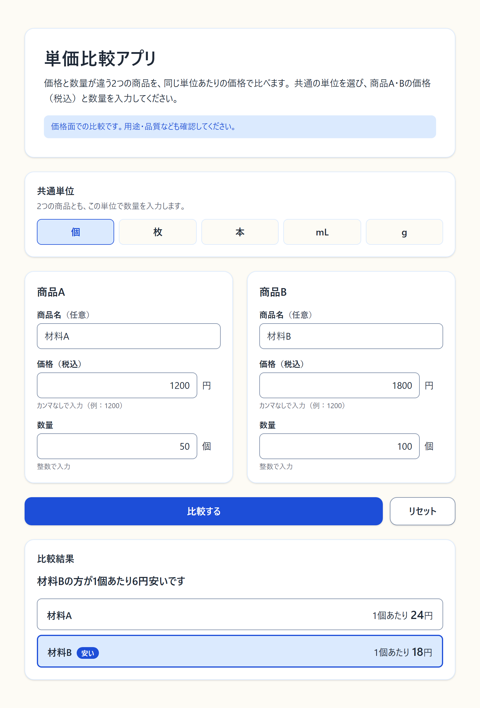

# 単価比較アプリ

価格と数量が違う2つの商品を、同じ単位あたりの価格で比べる日本語の Web アプリです。

## どんな不便を解決するか

アートメイクの材料を購入する施術者や、日用品を買う人に向けたアプリです。

「1,200円で50個入り」と「1,800円で100個入り」のように、商品ごとに価格と容量・入数が違うと、どちらがお得か分かりにくくなります。そのたびに電卓で割り算をする手間を減らし、価格面で選びやすくします。

## スクリーンショット

単位「個」で、材料A（1,200円／50個）と材料B（1,800円／100個）を比較した画面です。



## 公開URL

未追加（Vercel にはまだ公開していません）

## 機能

- **共通単位の選択**：個・枚・本・mL・g から1つ選びます（最初は「個」）。2つの商品とも、この単位で数量を入力します。
- **商品の入力**：商品A・Bそれぞれに、商品名（任意）、税込価格、数量を入力します。
- **比較**：それぞれの単価、安い方（「安い」のバッジ付き）、単位あたりの差額を表示します。
- **入力チェック**：空欄や範囲外の値があると計算せず、「商品Aの価格：価格を入力してください。」のように、どの商品のどの欄を直せばよいかを日本語で表示します。
- **古い結果の消去**：結果を表示したあとに入力や単位を変えると、古い結果を消して、もう一度比較するよう案内します。
- **リセット**：入力・単位・結果・エラーを初期状態に戻します。

## 使い方

1. 共通単位を選びます。
2. 商品A・Bの価格（税込）と数量を入力します。商品名は空欄のままでもかまいません。その場合は「商品A」「商品B」と表示されます。
3. 「比較する」を押します。数量欄で Enter キーを押しても比較できます。
4. 最初からやり直すときは「リセット」を押します。

例：1,200円／50個 と 1,800円／100個 を比べると、単価は24円と18円で、「商品Bの方が1個あたり6円安いです」と表示されます。

## 計算ルール

- 単価 ＝ 価格 ÷ 数量（日本円、税込）。
- どちらが安いか（または同じ単価か）の判定は、表示用に丸める前の値で行います。小数の誤差が出ないよう、割り算をせずに「価格A × 数量B」と「価格B × 数量A」を整数で比べています。
- 単価と差額は、小数第2位で四捨五入して表示します。末尾の0は省きます（例：24円、24.5円、24.53円）。
- 完全に同じ単価のときは「同じ単価です」と表示します。
- 単価に差はあるのに、表示上は同じに見える場合（差額が0.01円未満など）は、安い方を示したうえで「表示は小数第2位までのため、差が見えない場合があります」と案内します。

## 入力できる範囲

| 項目 | 範囲 |
|---|---|
| 価格 | 1〜1,000,000円の整数。カンマなしで入力します |
| 数量（個・枚・本） | 0より大きく1,000,000以下の整数 |
| 数量（mL・g） | 0より大きく1,000,000以下。小数第3位まで |

- 全角数字は半角に変換して受け付けます（例：「１２００」）。
- カンマ・記号・指数表記（1e3 など）は受け付けません。

## 保存しないこと

- 入力内容は画面の中（React の状態）だけで保持します。再読み込みすると消えます。
- localStorage・sessionStorage・Cookie には保存しません。
- 入力内容の外部への送信や、ログへの出力はしません。外部 API やデータベースも使いません。

## 比較の対象外

このアプリが比べるのは、入力した価格と数量から計算した単価だけです。次のものは比較の対象外です。

- 送料、ポイント、クーポン、まとめ買いなどの割引
- 品質、安全性、使い勝手などの評価
- 異なる単位の換算（mL と g など）、通貨の換算

購入するときは、用途・品質なども確認してください。

## 技術スタック

- Next.js 16（App Router）、React 19
- TypeScript
- Tailwind CSS 4
- Vitest、Testing Library（jsdom）
- ESLint（eslint-config-next）

## 開発

Node.js と npm が必要です（開発は Node.js 24 で行っています）。

```bash
npm install          # 依存パッケージのインストール
npm run dev          # 開発サーバー（http://localhost:3000）
npm test             # テスト（Vitest）
npm run lint         # lint（ESLint）
npm run build        # 本番ビルド
npm start            # 本番ビルドの起動
```

1つのテストファイルだけを実行する場合：

```bash
npx vitest run lib/compare.test.ts
```

## ディレクトリ構成

```
app/          ページとレイアウト
components/   画面のコンポーネント（入力・結果・状態の管理）
lib/          入力チェックと単価計算（画面から切り離した関数とテスト）
```

## 関連ドキュメント

- [requirements.md](requirements.md)：要件定義書
- [DEVLOG.md](DEVLOG.md)：開発中のつまずきと解決方法、確認結果の記録
